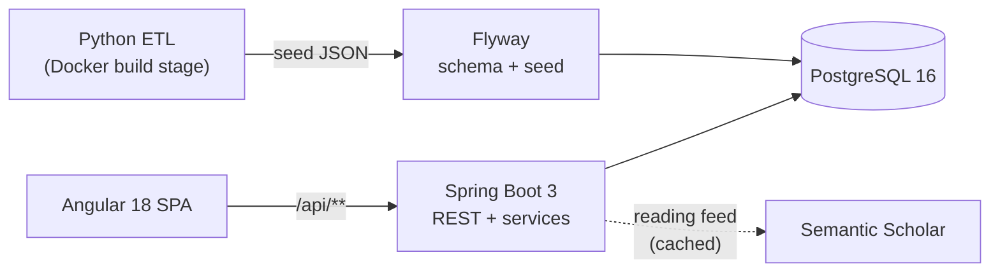

# Algorithm Patterns Trainer

*[Leia em português](README.pt-BR.md)*

A self-hosted **spaced-repetition trainer for coding-interview algorithm patterns**. Instead of grinding random problems, it teaches **14 macro-patterns** (HashMap, Two Pointers, Sliding Window, …, Trie/Bits) through a curated sequence of 46 core problems. It then keeps them fresh with a **capacity-aware review queue**: 2 exercises a day, always the ones you are most likely to have forgotten.

   

<!-- Screenshots: add images under docs/assets/ and reference them here. -->

## Why it is interesting

- **No due dates, no backlog explosion.** Each problem has a forgetting-curve urgency, `1 − e^(−Δt/stability)`, computed on read. Stability adapts to an exponential moving average of your results and to your speed versus a per-difficulty target. See [docs/algorithm.md](docs/algorithm.md).
- **Phased curriculum.** An introduction phase walks through the fixed sequence. A consolidation phase follows: pure review, topped up from your *weakest* pattern. A free phase lets you explore. See [docs/features/daily-session.md](docs/features/daily-session.md).
- **Reproducible data pipeline, no data in git.** A small Python ETL merges two public datasets (pinned by commit) and maps the official LeetCode tags to the 14 patterns. It runs inside the Docker build. See [docs/etl.md](docs/etl.md).
- **One container in production.** The Angular build is packaged inside the Spring Boot jar, and Flyway owns the schema and the seed import.

## Features

| Screen | What it does | Doc |
|---|---|---|
| **Hoje** (Today) | 2 pinned daily exercises, a built-in timer, result recording, and an optional review bar | [daily-session](docs/features/daily-session.md), [attempt-recording](docs/features/attempt-recording.md) |
| **Explorar** (Explore) | A random problem from about 2,900 problems, filtered by pattern, never-attempted first | [explore](docs/features/explore.md) |
| **Stats** | A consistency heatmap, streaks, average time per difficulty, and weak/strong patterns | [stats](docs/features/stats.md), [patterns-progress](docs/features/patterns-progress.md) |
| **Histórico** (History) | The full attempt log, filterable by difficulty and day | [history](docs/features/history.md) |
| **Leitura** (Reading) | Recent, well-cited papers per topic (Semantic Scholar, cached 14 days) | [reading-feed](docs/features/reading-feed.md) |

The UI is in Portuguese; the code, the API and the docs are in English.

## Architecture



More detail in [docs/architecture.md](docs/architecture.md) and [docs/data-model.md](docs/data-model.md).

## Quick start

Requirements: Docker with Compose. The first build needs internet access to fetch the public datasets.

```bash
git clone <this repo> && cd <repo>
cp .env.example .env          # optional, every value has a default
docker compose up --build -d
```

Open <http://localhost:8080>. Your progress lives in the `pgdata` Docker volume; `docker compose down -v` erases it.

### Development

```bash
docker compose up -d db                  # Postgres only
scripts/seed.sh                          # generate the seed locally
cd backend && SPRING_DATASOURCE_URL=jdbc:postgresql://localhost:5435/app_leetcode mvn spring-boot:run
cd frontend && npm install && npx ng serve   # http://localhost:4200 (proxies /api)
```

### Tests

```bash
cd backend && mvn test                         # scheduling algorithm + session planner
cd frontend && npx ng build                    # type-check + production build
python3 -m unittest discover -s tools/etl      # ETL, synthetic fixtures only
```

## Tech stack

| Area | Stack |
|---|---|
| Backend | Java 21, Spring Boot 3.3 (Web, Data JPA, Validation), Flyway, PostgreSQL 16, JUnit 5 |
| Frontend | Angular 18 (standalone components, lazy routes), Angular Material, RxJS |
| Data | Python 3 standard-library ETL |
| Ops | Multi-stage Dockerfile (ETL → Angular → Maven → JRE), Docker Compose |

## Documentation map

```
docs/
├── architecture.md      system overview, packages, boot sequence
├── data-model.md        ER diagram, tables, app_state keys, enums
├── api.md               every endpoint with request/response shapes
├── algorithm.md         urgency, EMA, stability rules and tunables
├── etl.md               data pipeline, curated mappings, licensing
├── operations.md        running, env vars, troubleshooting
├── features/            one doc per feature, same template
├── decisions/           architecture decision records (ADRs)
└── spec/                the original planning spec (historical)
```

AI coding agents: start at [`CLAUDE.md`](CLAUDE.md).

## Data & licensing

The code is released under the [MIT License](LICENSE). **This repository contains no problem data.** The catalog is generated at build time from [`neenza/leetcode-problems`](https://github.com/neenza/leetcode-problems) and [`zerotrac/leetcode_problem_rating`](https://github.com/zerotrac/leetcode_problem_rating); see their licenses. LeetCode is a trademark of its owner; this project is not affiliated with or endorsed by LeetCode.
