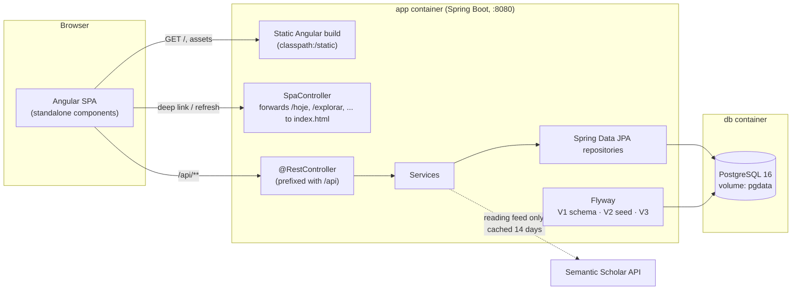

# Architecture

## Overview



The app runs as one Spring Boot process that serves both the REST API and the compiled Angular app. In development, `ng serve` (port 4200) proxies `/api` to the backend ([`frontend/proxy.conf.json`](../frontend/proxy.conf.json)).

## Repository layout

```
backend/                          Spring Boot 3 (Java 21, Maven)
  src/main/java/com/appleetcode/backend/
    BackendApplication.java
    config/                       AppClock (timezone), SessionProperties (algorithm knobs), WebMvcConfig (/api prefix)
    seed/SeedDtos.java            JSON shape of the seed files
    src/controller/               REST controllers + SpaController + ApiExceptionHandler
    src/controller/dto/           Request/response records
    src/service/                  Business logic (one service per feature)
    src/repository/               Spring Data JPA repositories (JPQL queries live here)
    src/entity/                   JPA entities + enums (AttemptResult, Phase)
  src/main/java/db/migration/     V2__Seed_data.java (Flyway Java migration)
  src/main/resources/
    application.yml               All tunables (app.session.*, app.papers.*, app.timezone)
    db/migration/                 V1__schema.sql, V3__daily_session_items.sql
    seed/                         Generated by the ETL; git-ignored
  src/test/java/...               JUnit 5 tests (ReviewSchedulerService, SessionPlannerService)
frontend/                         Angular 18 (standalone components, Angular Material)
  src/app/
    app.routes.ts                 5 lazy-loaded routes
    core/models.ts                TypeScript mirrors of the API DTOs
    core/services/                One HTTP service per endpoint group
    features/<route>/             hoje, explorar, stats, leitura, historico
    shared/                       attempt-card, timer, clamped-note, helpers
tools/etl/                        Seed ETL (Python, stdlib only) + tests with synthetic fixtures
scripts/seed.sh                   Runs the ETL for local development
docs/                             This documentation
Dockerfile                        4 stages: ETL -> Angular build -> Maven build -> JRE runtime
docker-compose.yml                db + app
```

> The Java package is `com.appleetcode.backend.src.*` (with a literal `src` segment). It is unusual, but it is the established layout; keep new classes in the matching `controller/service/repository/entity` package.

## Request flow

1. The browser loads `/`, which is served from `classpath:/static/index.html`.
2. Angular's router renders the feature component. Deep links and refreshes on `/hoje`, `/explorar`, `/stats`, `/leitura` and `/historico` hit [`SpaController`](../backend/src/main/java/com/appleetcode/backend/src/controller/SpaController.java), which forwards them to `index.html`.
3. Feature components call a `core/services/*.service.ts`, which calls `/api/...`.
4. [`WebMvcConfig`](../backend/src/main/java/com/appleetcode/backend/config/WebMvcConfig.java) adds the `/api` prefix to every `@RestController`, so the API never collides with SPA routes ([ADR 0004](decisions/0004-api-path-prefix.md)).
5. The controller is thin and delegates to a service. The service holds the transaction boundaries (`@Transactional`) and uses repositories.

## Boot sequence

1. **Flyway runs during `DataSource` initialization**, before Tomcat accepts requests:
   - `V1__schema.sql`: all tables, plus the initial `app_state` (`current_phase=introducao`, `current_day=1`, `last_pure_repetition_day=0`).
   - `V2__Seed_data` (Java): reads `classpath:/seed/seed_problems.json` and `seed_topics.json`, and inserts patterns, problems, `problem_patterns`, `plan_items` and topics. It fails, and is retried on the next boot, if the seed is missing ([ADR 0002](decisions/0002-seed-as-flyway-java-migration.md)).
   - `V3__daily_session_items.sql`: the per-day pinned session slots.
2. **Hibernate validates the schema** (`ddl-auto: validate`). Entities never create tables.
3. **Tomcat starts** on 8080.

## Cross-cutting concerns

| Concern | Where | Notes |
|---|---|---|
| "What day is it?" | [`AppClock`](../backend/src/main/java/com/appleetcode/backend/config/AppClock.java) | Always use `AppClock`, never `ZoneId.systemDefault()`. Configured by `app.timezone` / `APP_TIMEZONE` ([ADR 0005](decisions/0005-fixed-app-timezone.md)) |
| Algorithm constants | [`SessionProperties`](../backend/src/main/java/com/appleetcode/backend/config/SessionProperties.java) + `application.yml` `app.session.*` | Time targets, stability caps, repetition gap |
| Errors | [`ApiExceptionHandler`](../backend/src/main/java/com/appleetcode/backend/src/controller/ApiExceptionHandler.java) | `EntityNotFoundException` → 404 `{error}`. Bean Validation failures → Spring's default 400 |
| Auth | none | Single-user, local app by design |
| External calls | `PapersService` only | Everything else works offline |

## Docs index

- **Reference:** [data-model.md](data-model.md), [api.md](api.md), [algorithm.md](algorithm.md), [etl.md](etl.md), [operations.md](operations.md).
- **Features:** [features/](features/), one file per feature, all using the same template.
- **Decisions:** [decisions/](decisions/), the architecture decision records.
- **History:** [spec/original-spec.md](spec/original-spec.md).
