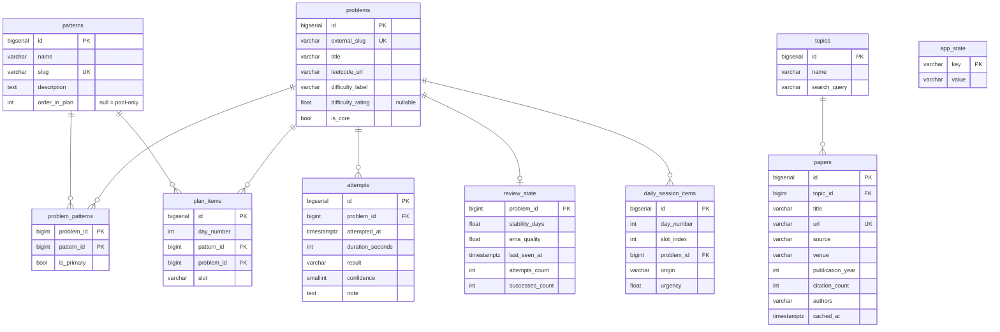

# Data model

Schema source: [`V1__schema.sql`](../backend/src/main/resources/db/migration/V1__schema.sql) and [`V3__daily_session_items.sql`](../backend/src/main/resources/db/migration/V3__daily_session_items.sql). Hibernate only validates (`ddl-auto: validate`).

**Migrations are append-only.** Never edit an applied migration: Flyway checksums would fail on existing databases. Add `V4__...` instead.

## Tables

### Catalog: written only by the seed (`V2__Seed_data`)

| Table | Purpose | Notes |
|---|---|---|
| `patterns` | The 14 macro-patterns (HashMap/Set, Two Pointers, …, Trie/Bits) | `order_in_plan` 1–14 sets the teaching order |
| `problems` | About 2,900 problems | `is_core=true` for the 46 problems of the fixed sequence; the rest are the exploration pool. `difficulty_label` is `Easy`/`Medium`/`Hard` and drives time targets and stability caps |
| `problem_patterns` | Many-to-many | `is_primary` marks the most specific matched pattern |
| `plan_items` | The fixed phase-1 sequence | `day_number` orders it. A plan item counts as "introduced" once its problem has a `review_state` ([PlanItemRepository.findNextNotIntroduced](../backend/src/main/java/com/appleetcode/backend/src/repository/PlanItemRepository.java)) |
| `topics` | Reading-feed topics | `search_query` is sent as-is to Semantic Scholar |

### User progress: written at runtime

| Table | Written by | Notes |
|---|---|---|
| `attempts` | `AttemptsService.record` | Append-only log. `result` is the `AttemptResult` enum name. `attempted_at` is UTC; group by day through `AppClock` |
| `review_state` | `AttemptsService.record` → `ReviewSchedulerService.recordAttempt` | One row per problem ever attempted. **Its existence means "introduced"** |
| `daily_session_items` | `SessionPlannerService.buildTodaySession` | The pinned slots for each `day_number`, `UNIQUE(day_number, slot_index)`. `origin` ∈ `novo`, `revisao`, `pool` |
| `app_state` | `SessionPlannerService` | Key-value store, see below |
| `papers` | `PapersService` | A cache: rows for a topic are replaced when the topic is refreshed. `url` is unique across topics |

### `app_state` keys

| Key | Values | Meaning |
|---|---|---|
| `current_phase` | `introducao` · `consolidacao` · `livre` | Switches to `consolidacao` automatically when no plan item is left to introduce |
| `current_day` | integer, starts at `1` | Advances by 1 on the first `GET /api/today` of each new calendar day, not by elapsed days |
| `last_session_date` | ISO date | The calendar date (in `app.timezone`) when `current_day` last advanced |
| `last_pure_repetition_day` | integer | The last day number built as a pure-repetition day |

## Enums

**`AttemptResult`** ([source](../backend/src/main/java/com/appleetcode/backend/src/entity/AttemptResult.java)) maps each result to a quality score `q` used by the algorithm:

| Value | q |
|---|---|
| `GAVE_UP` | 0 |
| `FAILED` | 1 |
| `SOLVED_WITH_HEAVY_HINT` | 2 |
| `SOLVED_WITH_HINT` | 3 |
| `SOLVED` | 4 |
| `SOLVED_FAST_NAMED_PATTERN` | 5 |

`q ≥ 3` counts as a success.

**`Phase`**: `INTRODUCAO`, `CONSOLIDACAO`, `LIVRE`, stored lowercase in `app_state`.
