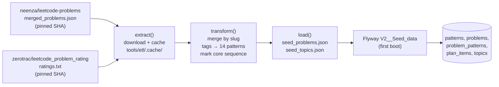

# Seed ETL

**No generated data is committed to this repository.** The problem catalog is produced by [`tools/etl/generate_seed.py`](../tools/etl/generate_seed.py) from public datasets, pinned by commit. The output is git-ignored (`backend/src/main/resources/seed/*.json`) and loaded into Postgres by the Flyway migration `V2__Seed_data` on first boot ([ADR 0007](decisions/0007-etl-at-build-time-no-data-in-repo.md)).

## Pipeline



| Stage | What it does |
|---|---|
| **Extract** (`fetch_cached`, `extract`) | Downloads each source from `raw.githubusercontent.com/<repo>/<sha>/...`. The cache file name includes the SHA, so changing a pin downloads fresh data automatically. `--offline` fails instead of downloading |
| **Transform** (`transform`, `classify_patterns`, `load_ratings`) | Dedupes by slug (first wins). Attaches the numeric rating when the slug has one. Maps official tags to patterns through `TAG_TO_PATTERN_PRIORITY`: the first matching tag is primary, later matches are secondary. DP plus `String`/`Matrix` is promoted to `dp-2d-strings`. Intervals has no official tag and uses the `EXTRA_POOL_SLUGS_BY_PATTERN` curated list. Core problems always get their curated pattern, even when no tag matches. The run aborts if any core problem is missing from the dataset |
| **Load** (`load`) | Writes `{patterns, problems}` and `{topics}` as JSON |

## Curated tables (edit these, not the output)

| Constant | Meaning |
|---|---|
| `PATTERNS` | The 14 macro-patterns, with `slug`, `name`, `order_in_plan` and a description of how to recognize each one |
| `CORE_PROBLEMS_BY_PATTERN` | The fixed phase-1 sequence: 46 problems, in teaching order within each pattern |
| `TAG_TO_PATTERN_PRIORITY` | Official tag → pattern, ordered from most to least specific. Generic tags (Array, Math, Sorting, …) are deliberately absent |
| `EXTRA_POOL_SLUGS_BY_PATTERN` | Hand-picked pool problems for patterns without an official tag |
| `TOPICS` | Reading-feed topics (`name`, `search_query` for Semantic Scholar) |
| `PROBLEMS_SOURCE` / `RATINGS_SOURCE` | Dataset URLs and the pinned commit SHAs |

## Running it

```bash
scripts/seed.sh                                   # writes backend/src/main/resources/seed/
python3 tools/etl/generate_seed.py --out /tmp/x   # any output dir
python3 tools/etl/generate_seed.py --offline      # use the cache only
```

The Docker build runs it automatically in its first stage (`seed-build`). Requirements: Python 3.10+, standard library only, and internet access the first time.

**Changing the seed does not update an existing database.** `V2` runs once. To apply a new seed you need a fresh volume, which deletes your progress (see [operations.md](operations.md)), or a new migration that applies the changes incrementally.

## Tests

[`tools/etl/test_transform.py`](../tools/etl/test_transform.py) runs against **synthetic fixtures** in [`tools/etl/fixtures/`](../tools/etl/fixtures/): made-up slugs, no network, no real records.

```bash
python3 -m unittest discover -s tools/etl -v
```

## Licensing of the sources

The datasets are fetched at build time and **not redistributed** by this repository. Check each project's license before redistributing generated output:

- [`neenza/leetcode-problems`](https://github.com/neenza/leetcode-problems)
- [`zerotrac/leetcode_problem_rating`](https://github.com/zerotrac/leetcode_problem_rating) (MIT)

Problem titles and URLs refer to LeetCode, a trademark of its owner. This project is not affiliated with LeetCode.
